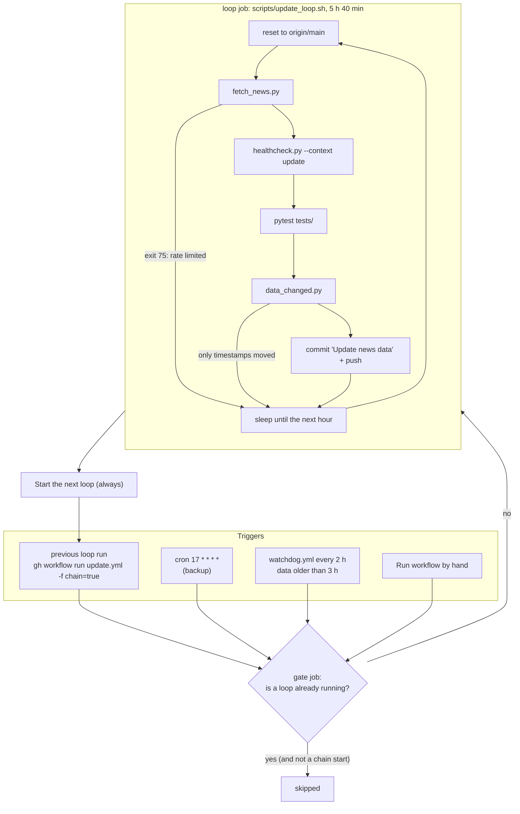
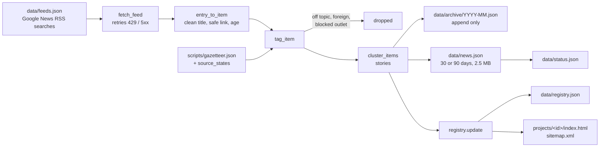
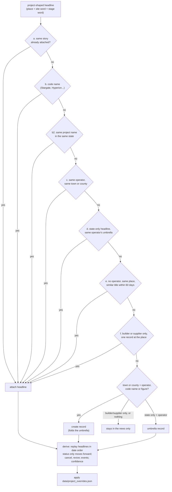
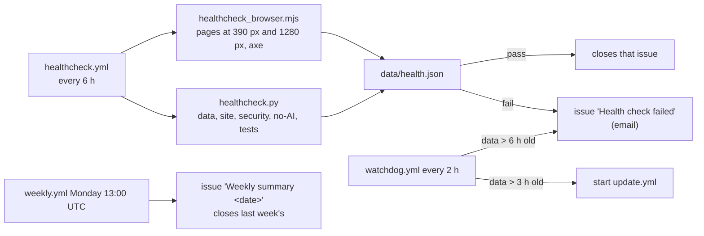

# Architecture

The Rack Report is a static site. GitHub Actions writes JSON files and static project pages into
the repository; GitHub Pages serves the repository; the pages load the JSON in the browser. There
is no server, no database and no AI service (docs/DECISIONS.md, decision 1).

## The hourly loop

A failure in the health check or the tests blocks that cycle's commit; the next cycle tries
again from the latest `main`. The loop exits red only if no cycle succeeded.

## Inside fetch_news.py

`tag_item` decides, with rules only:

| Field | How | Where |
|---|---|---|
| on topic | names a data center, or an operator plus a site word | `ON_TOPIC_RE`, `SITE_RE` |
| U.S. only | a U.S. place, no foreign marker, not a foreign outlet | `FOREIGN_RE`, `FOREIGN_SOURCES`, `us_filter` |
| `category` | first matching topic rule | `CATEGORY_RULES`, `OPINION_LABEL`, `is_cancelled` |
| `state`, places | gazetteer names, ambiguous towns resolved by state context, outlet state last | `find_locations` |
| `companies` (operators) | whole-word, case-sensitive patterns with guards for common words | `COMPANIES`, `ALIASES` |
| `investors`, `builders`, `suppliers`, `utilities` | the same, separate lists | `INVESTORS`, `BUILDERS`, `SUPPLIERS`, `UTILITIES` |
| `capacity_mw`, `investment_usd_b` | figures in the title | `extract_numbers` |
| `name_hint` | "Project X", "X Data Center", "X campus", "X Technology Park" | `name_hint` |
| stage signal | first status rule whose match describes the present | `STATUS_RULES`, `stage_counts` |

## Inside the registry

Status moves Announced → Under construction → Operational and never back; Cancelled / Blocked
can be revived by a construction or opening headline. Curated projects (`data/projects.json`)
keep their curated status.

## Watching over it

## Files at a glance

| Path | What |
|---|---|
| `scripts/fetch_news.py` | Fetch, tag, cluster, archive, write news.json; all tagging rules |
| `scripts/registry.py` | Project registry, overrides, project pages, sitemap |
| `scripts/update_loop.sh` | The hourly loop run by update.yml |
| `scripts/healthcheck.py`, `scripts/healthcheck_browser.mjs` | Health checks |
| `scripts/no_ai.py` | The ground-rule scanner |
| `scripts/weekly_summary.py` | The Monday summary issue |
| `scripts/data_readme.py` | Field descriptions; generates docs/DATA_DICTIONARY.md |
| `scripts/data_changed.py` | Whether a cycle changed anything worth committing |
| `scripts/retag_archive.py` | Re-tag the whole archive after a rule change |
| `scripts/status_audit.py` | Check the status rules against a stricter reading |
| `scripts/source_states.py`, `scripts/gazetteer_towns.py` | Suggest outlet home states; add GeoNames towns |
| `scripts/backfill_news.py`, `scripts/backfill_report.py` | Fetch older headlines; report on it |
| `scripts/seed_archive.py` | Historical: built the first archive from git history |
| `tests/` | pytest suite; run before every commit |
| `data/` | All data; see docs/DATA_DICTIONARY.md |
| `assets/` | CSS, JavaScript, brand images |
